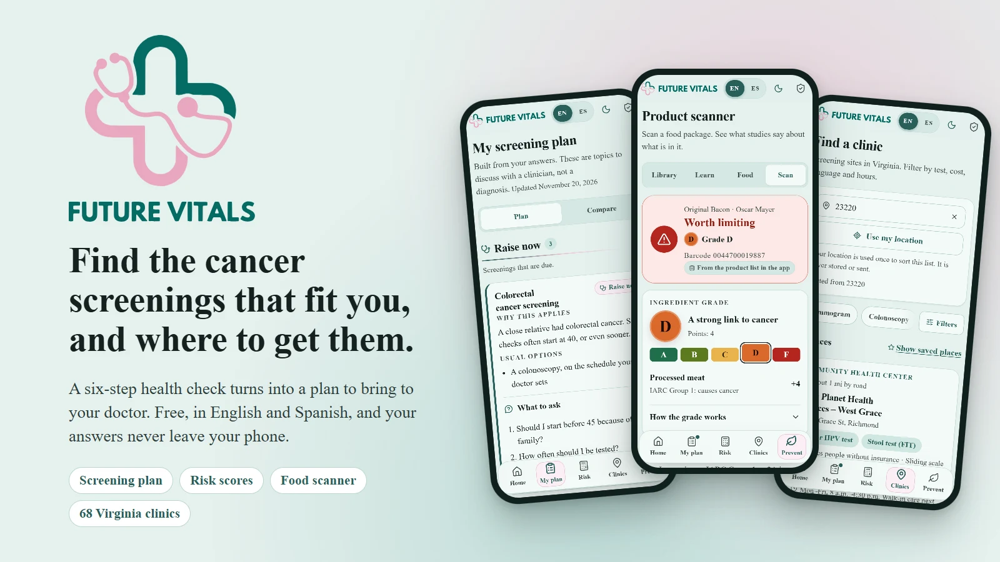
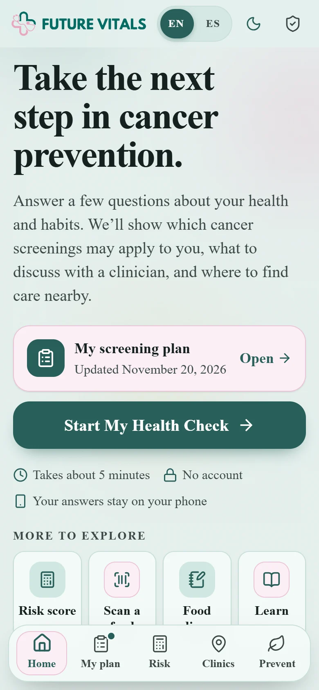
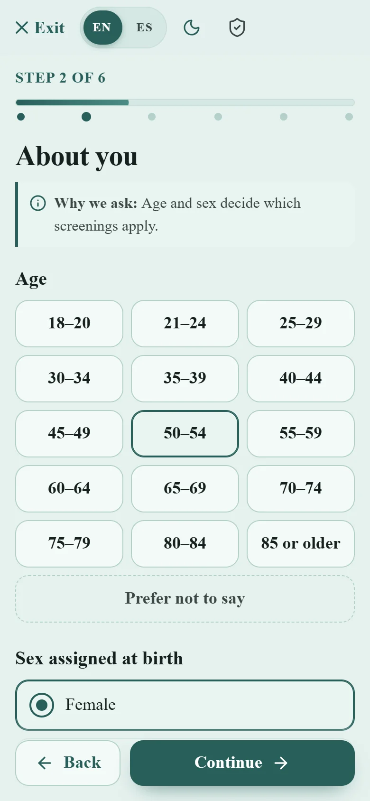
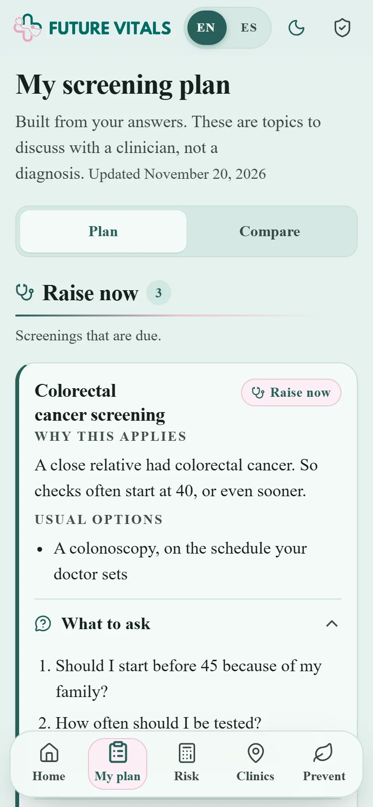
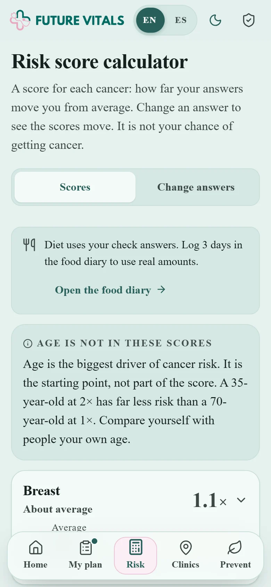
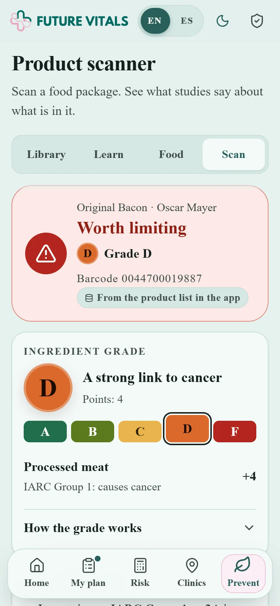
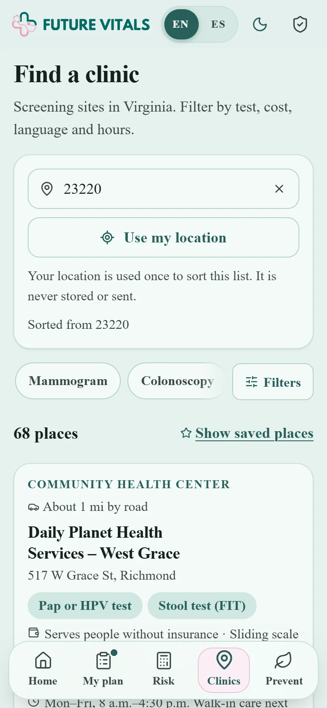

<p align="center">
  
</p>

<p align="center">
  <a href="https://parvbansal09.github.io/FutureVitals/"><strong>Try the live app</strong></a>
  ·
  <a href="#run-it-on-your-computer">Run it yourself</a>
  ·
  <a href="https://github.com/parvbansal09/FutureVitals/issues">Report a problem</a>
</p>

# FutureVitals

FutureVitals helps people in Virginia find out which cancer screenings may
apply to them and where to get them. You answer a six-step health check; the
app turns your answers into a plan of what to raise with a clinician, shows a
risk score for 11 cancers with the source behind every number, checks food
labels for ingredients linked to cancer, and finds screening sites near you.

It is free, it works in English and Spanish, and it has no account and no
server: everything you type stays on your phone.

> FutureVitals gives general information, not medical advice. It has not yet
> been reviewed by a clinician. Use it to start a conversation with your
> doctor, not in place of one.

## Screens

| Home | Health check | Screening plan |
|:---:|:---:|:---:|
|  |  |  |
| **Risk scores** | **Food scanner** | **Find a clinic** |
|  |  |  |

## What it does

- **Health check and screening plan.** Six short steps (symptoms, age and sex,
  family history, past health, habits, body). The plan matches your answers to
  published guidelines (USPSTF, American Cancer Society, AASLD) and says, for
  each screening, why it applies, the usual options and what to ask. Warning
  signs are flagged first. The plan can be printed or shared.
- **Risk score calculator.** A score for 11 cancers, shown as a multiple of
  average for someone your age and sex (for example 1.8×). Each factor uses a
  relative risk from a named study. Change an answer and the score moves; the
  biggest change you could make has a "Try this change" button.
- **How you compare.** Your habits next to the advice, with the source quoted
  and one first step for each.
- **Food scanner.** Take a photo of a barcode or search by name across 80,000
  U.S. products from Open Food Facts, stored in the app so it works offline.
  Each product gets a label (Worth limiting, Fine in moderation, No cancer
  evidence) and an ingredient grade from A to F based on how strong the
  evidence is for each ingredient linked to cancer. You can also photograph
  an ingredient list; the text is read on the phone.
- **Food diary.** Log servings for the last 7 days. Once 3 days are logged,
  the diary feeds the comparison and the risk scores.
- **Find a clinic.** 68 screening sites across Virginia, sorted by distance
  from a ZIP code or your location, with filters for test, cost, language and
  hours, and buttons to call or get directions.
- **Learn and prevent.** 10 short chapters, 10 myth-or-fact cards, and a
  prevention library on tobacco, alcohol, weight, activity, diet, vaccines,
  sun and radon.

### Built for everyone

- English and Spanish on every screen, written at a 6th-grade reading level
  (checked automatically).
- Every control at least 44 × 44 px; text can be scaled up to 200%; tested
  against WCAG 2.2 AA with axe-core in light and dark mode.
- Opens in light mode, with a dark mode one tap away. Animations respect
  "reduce motion".
- Helper mode for community health workers who fill in the check for someone
  else.
- Installable as a web app and works offline.

### Private by design

There is no account, no analytics and no server. Answers, the plan and the food
diary are saved only on the device and can be deleted with one button. The
only things that go online are ones you ask for: looking up a barcode that is
not in the built-in list, and opening a link, phone number or map you tap.
An automated test fails the build if anything else leaves the device.

## Run it on your computer

You need [Node.js](https://nodejs.org/) 20.19 or newer (22 recommended) and
Git.

```bash
git clone https://github.com/parvbansal09/FutureVitals.git
cd FutureVitals
npm install        # also copies the on-device text reader into public/ocr
npm run dev        # starts the app at http://localhost:5173
```

Open <http://localhost:5173>. On a computer the app is shown inside a phone
frame; on a phone it fills the screen. To try it on your phone, run
`npm run dev -- --host` and open the address it prints on a phone on the same
Wi-Fi network.

On Windows, if PowerShell says running scripts is disabled, use
`node scripts/dev.mjs --open` instead of `npm run dev`; it starts the same
server and opens the browser. Opening `index.html` directly from the folder
does not work, because the app needs a server.

### Build for production

```bash
npm run build      # type-check and build into dist/
npm run preview    # serve the build at http://localhost:4173
```

`dist/` is a static site and can be hosted anywhere:

- **GitHub Pages:** `.github/workflows/pages.yml` builds and publishes the app
  on every push to `main`. This is how the live app above is hosted.
- **Netlify:** `netlify.toml` holds the build settings. Import the repository
  in Netlify and deploy; nothing needs to be typed in.

### Run the tests

```bash
npm test               # 148 unit tests
npm run check:content  # reading level, text length, English/Spanish parity
npm run build && npm run e2e   # 56 end-to-end checks in a real browser
npm run a11y           # tap-target size and axe-core checks on 25 screens
npm run check:links    # every outside link and phone number still works
```

`e2e` and `a11y` drive the Microsoft Edge or Google Chrome already installed on
your computer, so nothing else is downloaded. To run the end-to-end checks
against a deployed copy instead, use
`node scripts/e2e.mjs --url=https://parvbansal09.github.io/FutureVitals/`. The same checks run on every push
in [GitHub Actions](.github/workflows/ci.yml).

The unit tests include 44 guideline personas and 4,000 randomly generated
people run through every screen, to make sure the plan, the risk scores and
the comparison always agree with the answers given (for example, someone who
says they never smoked is never shown as a smoker).

### Android and iOS

The same build is wrapped as a native app with
[Capacitor](https://capacitorjs.com/). The `android/` and `ios/` projects are
set up with icons, splash screens and permissions; building them needs Android
Studio or Xcode. See [NATIVE.md](NATIVE.md).

```bash
npm run sync           # build, then copy into android/ and ios/
npm run open:android   # open in Android Studio
npm run open:ios       # open in Xcode (on a Mac)
```

## How it works

```
content/          all wording, guideline rules, relative risks, clinics and links (JSON)
  strings/        English and Spanish text (a test makes sure the keys match)
  products/       80,000 products from Open Food Facts, with their grades
src/engine/       the rules: plain functions with no text, fully tested
src/screens/      one file per screen
src/components/   shared parts: buttons, cards, the logo, the tab bar
src/platform/     camera, barcode and text reading, storage, native features
src/styles/       design tokens and styles
tests/            unit tests
scripts/          content and link checks, end-to-end and accessibility tests,
                  screenshots, icon and product-list builders
android/, ios/    native app projects (Capacitor)
```

Two engines are kept apart on purpose:

- The **plan** is guideline matching. Your answers are read against published
  screening criteria; nothing is scored.
- The **risk score** multiplies published relative risks (the method of the
  Harvard Cancer Risk Index) into a score for each cancer, compared with an
  average person of the same age and sex. Neither shows a percentage chance or
  ranks cancers against each other.

Both read the same saved answers, so every screen always agrees. All clinical
wording and numbers live in `content/`, not in the code, so they can be
reviewed and updated without touching the logic.

**Tech:** React 19, TypeScript, Vite, Motion for animation, Zustand for saved
state, ZXing for barcodes, Tesseract.js for reading text on the device,
Capacitor for the native apps, Vitest and Playwright for tests.

More detail, including the history of the project and the reasoning behind
each risk factor, is in [docs/NOTES.md](docs/NOTES.md). How the
app should be written and reviewed is in [CONTENT-GUIDE.md](CONTENT-GUIDE.md).

## Sources

Screening advice comes from the U.S. Preventive Services Task Force, the
American Cancer Society, the CDC, the National Cancer Institute and the
American Association for the Study of Liver Diseases. Ingredient evidence
comes from the International Agency for Research on Cancer (IARC) and the
World Cancer Research Fund. Each relative risk in `content/risk.json` names
the study it comes from. Clinic listings were checked against each site's
public pages on 28 September 2026; call ahead to confirm.

## Limits

- No clinician has reviewed the rules yet, and a native speaker has not yet
  reviewed the Spanish. The app says both on its About and Language screens.
- Clinics and local programs cover Virginia only.
- The Android and iOS apps have not been published to the app stores.

Found a mistake? Please [open an issue](https://github.com/parvbansal09/FutureVitals/issues).
Do not include personal medical details.

## License

The code is released under the [MIT License](LICENSE).

The product list in `content/products/` contains data from
[Open Food Facts](https://world.openfoodfacts.org), available under the
[Open Database License](https://opendatacommons.org/licenses/odbl/1-0/); see
[content/products/LICENSE.md](content/products/LICENSE.md) and
[OPEN-FOOD-FACTS.md](OPEN-FOOD-FACTS.md). The Tinos font is under the Apache
License 2.0. Virginia ZIP code centers come from the U.S. Census Bureau
(public domain).
